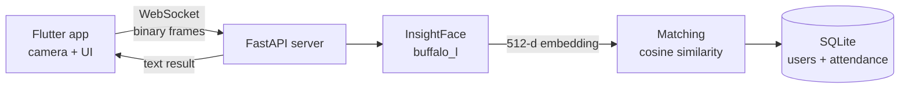

# face_detection
# Face Attendance System

A mobile attendance app that marks attendance by recognizing faces. A Flutter app streams camera frames to a FastAPI backend over WebSockets. The backend uses InsightFace to turn faces into embeddings and matches them against enrolled users.

> **Status:** 🚧 In active development (first iteration). See [Project status](#project-status) for what works and what is planned.

<!-- Add a demo GIF or screenshots here:  -->

## Features

- **Face enrollment:** capture about 5 seconds of frames, average the embeddings, and store one normalized embedding per user.
- **Face-based attendance:** recognize a user from live frames using cosine similarity and record a timestamped attendance entry with a confidence score.
- **Real-time streaming:** low-latency frame transport over WebSockets with a compact binary frame format.
- **Rejects bad frames:** frames with no face or with multiple faces are rejected with a message.

## Architecture



## Tech stack

| Layer | Technology |
|---|---|
| Mobile app | Flutter, Dart, `camera`, `web_socket_channel` |
| Backend | Python, FastAPI, WebSockets, Pydantic |
| Face recognition | InsightFace (`buffalo_l`), ONNX Runtime, OpenCV, NumPy |
| Storage | SQLite |

## How it works

**Enrollment** (`/ws/live-feed`)
1. The app sends a JSON text message with the user's details (`name`, `email`, `phoneNo`).
2. The app streams camera frames for about 5 seconds.
3. The server computes an embedding for every valid frame, averages them, L2-normalizes the result, and stores it in the `user` table.

**Attendance** (`/ws/live-feed/Login`)
1. The app streams frames.
2. For each frame the server computes an embedding and compares it with every stored user using cosine similarity.
3. If the best similarity is above the threshold (currently `0.65`), the server records an attendance row and replies with the user's name.

### Frame format

Each binary WebSocket message is a 12-byte header followed by the raw grayscale (Y plane) image bytes.

| Bytes | Content |
|---|---|
| 0-3 | width (uint32, big-endian) |
| 4-7 | height (uint32, big-endian) |
| 8-11 | bytes per row, including padding (uint32, big-endian) |
| 12-end | grayscale pixel data |

## Getting started

### Prerequisites
- Python 3.10 or newer
- Flutter SDK (Dart `>=3.0.0 <4.0.0`)
- An Android phone (the frame format currently assumes Android's YUV420 layout) on the same Wi-Fi network as your computer

### 1. Run the backend

```bash
cd backend
python -m venv venv
source venv/bin/activate          # Windows: venv\Scripts\activate
pip install fastapi "uvicorn[standard]" insightface onnxruntime opencv-python numpy pydantic
uvicorn main:app --host 0.0.0.0 --port 8000
```

On first run, InsightFace downloads its model files. The SQLite database (`test.db`) is created automatically.

### 2. Run the app

1. Find your computer's local IP address (for example `hostname -I` on Linux).
2. Set `kBaseWsUrl` in `lib/cammeraa/example.dart` to `ws://<your-ip>:8000/ws/live-feed`.
3. Then run:

```bash
flutter pub get
flutter run
```

## Project structure (current)

```
backend/
  main.py        # FastAPI app and WebSocket endpoints
  methods.py     # database helpers and face utilities
  tmpp.py        # liveness-detection prototype (not integrated yet)
lib/
  main.dart      # app entry point
  card.dart      # home screen cards
  cammeraa/      # camera + WebSocket streaming screen
  login/         # attendance screen
  register/      # enrollment form
```

A cleaner feature-based structure and naming cleanup is planned (see the roadmap).

## Project status

- [x] Face enrollment with averaged embeddings
- [x] Face recognition and attendance logging
- [x] Real-time frame streaming over WebSockets
- [ ] Prevent duplicate attendance on the same day
- [ ] Liveness detection (challenge-response) integrated into the app
- [ ] Admin features: list and delete users, daily report, CSV export
- [ ] Authentication and secure transport (WSS)
- [ ] Automated tests and CI
- [ ] Docker setup


